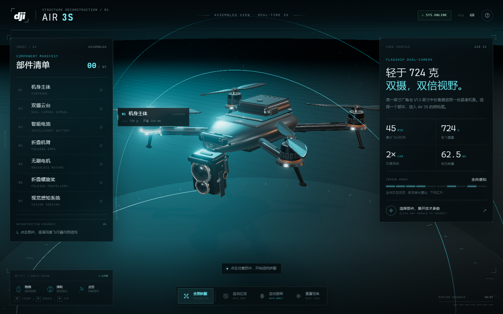

# DJI Air 3S · 结构拆解实验室

一个完整、可交互的 DJI Air 3S 三维拆解可视化页面。所有机体、云台、电池、机臂、电机与桨叶均由 Three.js 在运行时以代码生成，不依赖任何外部 3D 模型文件。



## 在线地址

- **Cloudflare Pages**：https://drone-threejs-app.pages.dev/
- **GitHub**：https://github.com/hefuhai001/drone-threejs-app

## 运行

最简方式：直接双击 `index.html`。Three.js 已打包进 `app.js`，通过 `file://` 打开即可正常运行，无需联网。

也可以启动本地静态服务器：

```bash
npm install
npm run serve
# → http://127.0.0.1:4173
```

修改 `src/main.js` 或 `style.css` 后重新打包：

```bash
npm run build
```

## 部署到 Cloudflare Pages

项目已托管在 Cloudflare Pages 的 `drone-threejs-app` 项目下。更新线上站点：

```bash
# 首次部署前先登录（OAuth）
npx wrangler login

# 构建 dist/ 并上传为生产部署
npm run deploy
```

`dist/` 中只包含运行页面所需的 `index.html`、`style.css`、`app.js`、`robots.txt` 与 `_headers`，不会上传源码或 `node_modules`。

## 交互

| 操作 | 功能 |
| --- | --- |
| 鼠标左键拖拽 / 单指滑动 | 自由旋转视角 |
| 滚轮 / 双指捏合 | 缩放 |
| 右键拖拽 | 平移观察中心 |
| 点击 3D 部件或左侧清单 | 展开 / 归位该部件，并打开参数详情 |
| `E` | 全部拆解 / 全部归位 |
| `T` | 自动巡览 |
| `A` | 自动旋转开关 |
| `R` | 重置视角与装配状态 |
| `H` | 打开操作指南 |
| `Esc` | 关闭指南 / 详情面板 |

底部控制栏还提供「全部拆解」「自动巡览」「自动旋转」「重置视角」按钮。右侧详情面板中的「定位视角」会将相机平滑移动到当前部件。

## 功能

- **程序化模型**：双摄三轴云台（上下堆叠的 1 英寸广角与 1/1.3 英寸中长焦镜头）、电池仓与智能电池、折叠机臂、四颗无刷电机、低噪双叶桨、前视激光雷达与全向视觉开孔，全部由 Three.js 几何体、材质与 Canvas 程序化贴图生成。
- **交互拆解**：7 个可独立拆解的部件组，带阻尼缓动与顺序延迟；拆解后自动生成技术标注与引线。
- **实时高亮**：悬停时轻微冷光提示，选中时材质自发光、局部光晕与脉冲标记同步响应。
- **参数面板**：每个部件附有中文结构说明、官方参数清单与来源标注。
- **技术 HUD**：深色科技背景、扫描线、程序化星空、环状展示台、UnrealBloom 光晕、实时 FPS 与坐标读数。
- **响应式布局**：桌面端双栏信息布局；移动端部件清单变为底部抽屉，详情变为可滚动底部面板，并自动调整相机视野。
- **无障碍**：可键盘访问的部件清单、面板按钮与标注，支持 `prefers-reduced-motion`。
- **分享定位**：可以通过 URL 参数打开指定状态，例如 `index.html?part=gimbal` 或 `index.html?view=exploded`。

## 结构

```
index.html        页面结构 / HUD / 面板
style.css         深色科技视觉与响应式布局
src/main.js       模型、场景、材质、交互与动画
app.js            esbuild 打包后的完整可运行脚本（含 Three.js）
server.mjs        本地静态服务器
scripts/          构建 Cloudflare Pages 部署目录
wrangler.toml     Cloudflare Pages 项目配置
test/             Playwright 自动化与截图
```

## 参数来源

相机、电池、尺寸与感知系统等官方参数参考 [DJI Air 3S 技术参数](https://www.dji.com/cn/air-3s/specs)。模型为按公开外观特征进行的程序化艺术还原，并非工程级 CAD 数据。
